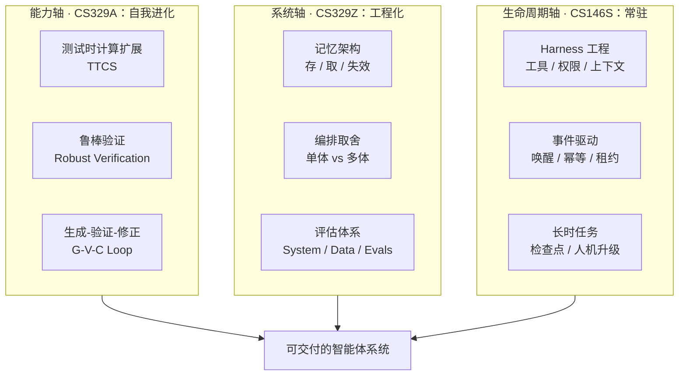
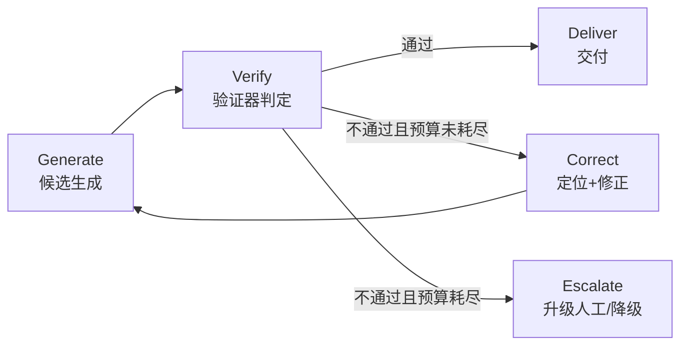
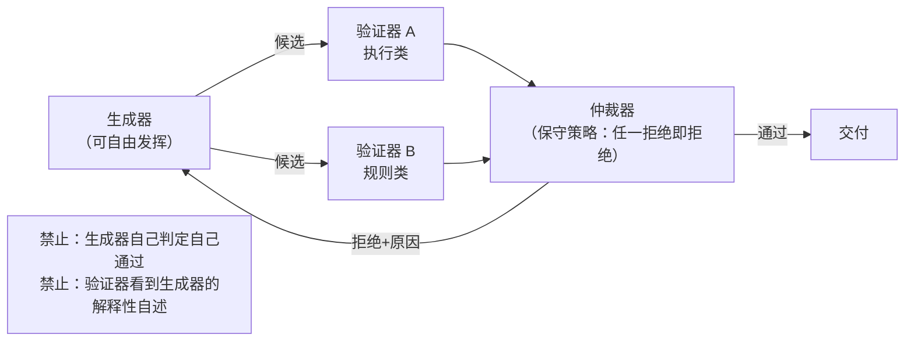
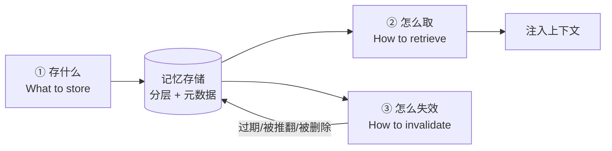
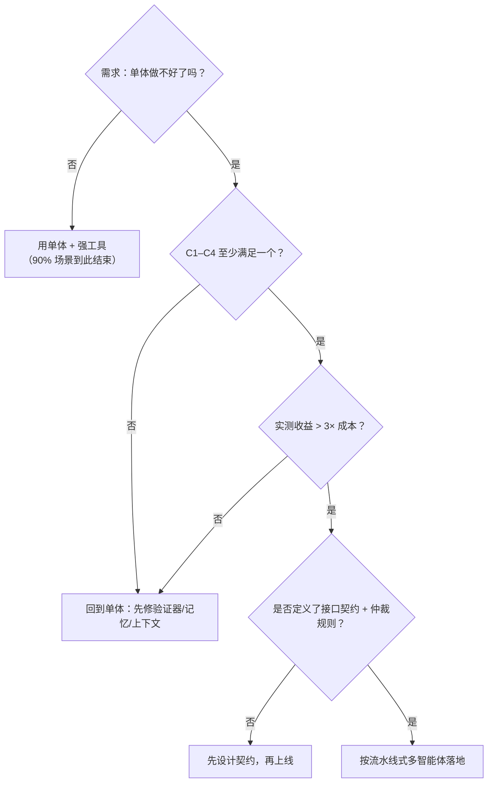
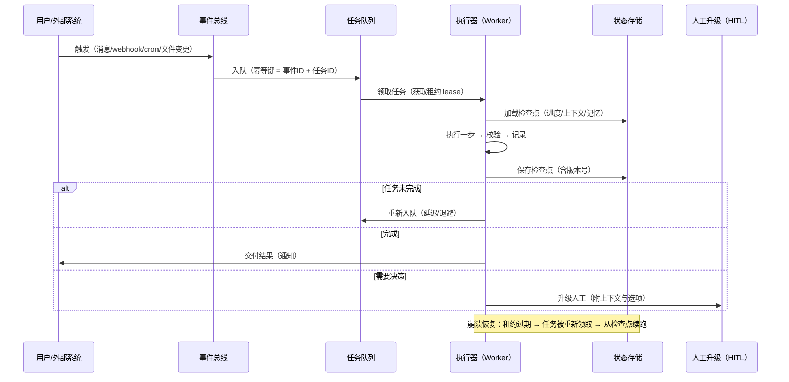

# 10 · 斯坦福 AI 智能体课程 2025–2026 学年更新笔记

> **文档定位**：本文件是 [12_Stanford_AI_Agents_Course_Notes](./12_Stanford_AI_Agents_Course_Notes.md) 的**工程化升级版**。
> 12 号文档解决"概念对齐"，本文件解决"**架构决策与验收标准**"——面向需要把智能体真正上线的工程场景（校本智能体、教研 Agent、常驻服务）。
>
> **课程来源**：Stanford CS329A / CS329Z / CS146S（2025–2026 学年）
> **整理口径**：以工程决策为主线，凡"课程命题 → 工程含义 → 判据/阈值 → 反模式"逐层落地；本文中的数量级数字（如成本倍数、命中率）为工程经验量级，非课程发布的基准数据，使用时需用自己的评估集重测。
> **维护约定**：本文件随课程内容与自测结果滚动更新，变更记录见文末附录 C。

---

## 0. 一页速览（TL;DR）

| # | 结论 | 对应的工程动作 |
|:-:|------|----------------|
| 1 | 三门课解决的是**三条正交轴**：能力增量（会不会变强）、系统可信（有没有工程骨架）、生命周期（关掉界面还活不活） | 任何智能体架构评审都要分别打分，不能用一个总分糊过去 |
| 2 | **测试时计算扩展（TTCS）不是"多想几次"，而是"在预算约束下分配采样宽度/搜索深度"** | 必须实现预算调度器 + 早停，否则 TTCS 只会放大成本 |
| 3 | TTCS 的收益上限由**验证器判别力**决定，不是由采样次数决定 | 先把验证器做好，再谈加算力；否则就是"更贵地犯错" |
| 4 | 鲁棒验证的核心不是"让模型判断对不对"，而是**让验证信号可执行、可复现、与生成方隔离** | 优先级：执行/测试 > 规则校验 > 多验证器交叉 > 单 LLM 裁判 |
| 5 | 记忆的难点**不在存，在失效**；不能失效的记忆等于负债 | 每条记忆落库时必须带 `source`、`valid_from`、`ttl/invalidated_by` |
| 6 | **约 90% 的场景不该上多智能体**；引入门槛是四个必要条件至少满足一个，且收益 > 3 倍成本 | 默认单体 + 强工具；多体只在"需要独立验证/并行探索/权限隔离/上下文隔离"时启用 |
| 7 | Harness 工程 = **模型之外的一切**（循环、工具、上下文、权限、状态、可观测） | 评估智能体强弱时，先看 Harness 成熟度，再看模型 |
| 8 | 常驻智能体的本质是"**事件驱动的状态机 + 幂等执行器**"，不是"进程一直开着" | 关闭 UI 后仍能工作，靠的是状态落盘 + 事件唤醒 + 租约防重 |

> 一句话：**CS329A 决定上限，CS329Z 决定下限，CS146S 决定"能不能一直待在线上"。**

---

## 1. 课程体系最新定位：三条正交轴

### 1.1 为什么必须用"正交"来理解

大多数人把三门课理解成"初级 → 中级 → 高级"的递进关系，这是**误读**。递进意味着学完后面就不用管前面，而真实工程里：

- 一个**自我进化能力很强**的智能体，如果没有 Harness，它连工具都调不稳；
- 一个 **Harness 很完整**的智能体，如果没有验证器，它的"自我改进"就是在放大幻觉；
- 一个**两者都不错**的智能体，如果状态只存在内存里，用户一关界面任务就丢。

因此三门课对应三个**可以独立变好、也可以独立变坏**的维度：



### 1.2 三门课的维度定义

| 维度 | 课程 | 回答的问题 | 失败时的典型症状 | 核心度量 |
|------|------|------------|------------------|----------|
| **能力增量轴**（能不能越用越强） | **CS329A** Self-Improving AI Agents | 给定预算，如何把"一次生成"变成"多次采样 + 验证 + 修正"的可控过程？ | 加算力后准确率不涨甚至下降；反思日志越写越长但错误照旧 | 精度-预算曲线、验证器判别力、修正成功率 |
| **系统轴**（工程骨架是否成立） | **CS329Z** Engineering AI Agents | 记忆怎么存/取/失效？什么时候才该拆多智能体？怎么量化评估？ | 上下文爆炸、检索到过期记忆、多 Agent 互相附和 | 误召回率、陈旧率、端到端成功率、token/任务 |
| **生命周期轴**（关掉界面还活不活） | **CS146S** The Modern Software Developer | 模型之外的一切怎么搭？任务能否跨会话、跨进程、无人值守地推进？ | 关窗口任务丢失、重启即失忆、重复执行产生脏数据 | 断点续跑成功率、幂等冲突率、MTTR |

### 1.3 正交性验证：两两不可替代

| 组合 | 缺失的那一维会怎样 |
|------|--------------------|
| 只有 A + B（无 C） | 智能体在单次会话内很聪明，但**任务无法跨越"用户离开"这件事**；一切长任务都退化成"用户必须在场" |
| 只有 B + C（无 A） | 系统很稳但**天花板被单次采样锁死**；遇到需要多路径尝试的难题直接放弃 |
| 只有 A + C（无 B） | 能自我改进也能常驻，但**记忆一塌糊涂、多智能体越拆越乱**，长期运行后行为漂移不可解释 |

> **评审用法**：任何一次智能体架构评审，先分别给三条轴打分（0–3 分），三条轴里最低的那条就是这次迭代唯一该修的东西。

### 1.4 三条轴与团队分工的映射

| 轴 | 主要负责角色 | 交付物 | 验收方式 |
|----|--------------|--------|----------|
| A 能力增量 | 算法/评估 | 验证器、预算调度器、评估集 | 在固定评估集上画精度-预算曲线 |
| B 系统 | 后端/架构 | 记忆服务、编排层、指标看板 | 误召回率、陈旧率、成功率达标 |
| C 生命周期 | 平台/SRE | 事件总线、任务队列、检查点 | 断点续跑演练、注入故障演练 |

---

## 2. CS329A：自我改进的技术路径

### 2.1 自我改进的最小闭环

CS329A 的主线不是"让模型反思一下"，而是把自我改进工程化成一个**有预算、有验证器、有停止条件**的循环：



三个必须显式定义的参数：

| 参数 | 含义 | 典型取值思路 |
|------|------|--------------|
| `budget` | 本次任务允许消耗的计算预算（token / 采样数 / 墙钟） | 按任务价值分档：低价值 1×，高价值 5–10× |
| `verifier` | 判定"通过/不通过"的信号来源 | 必须可执行、可复现，见 2.3 |
| `stop_rule` | 什么情况下停止 | 连续 N 次不通过 → 升级人工；收益增量 < 阈值 → 提前停 |

> **反直觉点一**：反思（Reflection）本身**不产生新信息**。它只是把"已有的失败信号"重新组织成上下文。如果失败信号本身不可信，反思就是在把噪声包装成经验。

### 2.2 测试时计算扩展（Test-Time Compute Scaling, TTCS）

#### 2.2.1 定义与工程含义

**定义**：在**推理阶段**（而非训练阶段）通过增加计算量来提升输出质量的一组技术；核心是"把推理预算当作一个可调超参"。

**工程含义**：TTCS 把一个原本"输入 → 输出"的确定性调用，变成一个**带预算约束的搜索/采样过程**。这意味着你的系统从"函数调用"升级为"带 SLA 的小型求解器"——必须回答三个新问题：

1. **预算从哪来**（谁决定这次任务值多少算力）
2. **预算怎么花**（宽度 vs 深度 vs 长度）
3. **什么时候停**（早停条件，否则预算永远被烧光）

#### 2.2.2 三个扩展维度

| 维度 | 做法 | 收益来源 | 代价 | 适用场景 |
|------|------|----------|------|----------|
| **宽度（Width）** | 并行采样 N 条独立候选，再由验证器择优 | 覆盖率提升：正确解出现在任一候选中的概率随 N 上升 | 成本随 N 线性增长；需要可靠的选择机制 | 答案可二值判定（数学题、代码单测、结构化抽取） |
| **深度（Depth）** | 串行搜索：树搜索 / 回溯 / 分支剪枝（ToT、LATS 类） | 能在中间步骤纠错，而非等到最后 | 延迟高、状态管理复杂、容易在错误分支上烧预算 | 需要多步推理且中间状态可评估（规划、证明、复杂调试） |
| **长度（Length）** | 单条轨迹内延长思考：更长的推理链、多次自我检查、草稿-复核 | 提升单条轨迹的自洽度 | 边际收益递减明显；过长会引入自我强化错误 | 写作、分析、方案设计等难以二值判定的任务 |

> **工程选择速查**：能用**可执行验证器**判定的任务（代码、SQL、数学、格式校验）→ 优先**宽度**；需要**过程评估**的任务（规划、研究）→ 深度；**开放性输出**（文案、方案）→ 长度 + 多验证器交叉，且必须设人工抽检。

#### 2.2.3 TTCS 的真实收益边界（最重要的一条结论）

采样 N 次后由验证器择优，最终准确率的近似关系：

```
P(最终正确) ≈ 1 − (1 − p_generate)^N          # 生成侧覆盖率（pass@N）
但实际交付准确率 = P(最终正确) × P(验证器正确接受)
                 + P(最终错误) × P(验证器错误接受)
```

由此得到三条工程推论：

1. **覆盖率会饱和**：`p_generate` 越低，N 增大带来的边际收益越差；当 N 从 8 涨到 64 而准确率只涨 1–2 个百分点时，就该停止加宽度。
2. **验证器判别力是天花板**：如果验证器的错误接受率是 `ε`，那么再多的采样也把错误率锁死在 `ε` 附近——**这是 TTCS 最容易被忽略的上限**。
3. **两者必须一起调**：先提升验证器，再扩采样。顺序反了，等于用更贵的价格买同一个错误。

#### 2.2.4 预算调度器（Budget Scheduler）

工程上不要给所有请求同一个预算，而要做**分档调度**：

```python
# 预算调度器：把"任务价值"映射成"采样预算"，并保证最坏情况可预测
from dataclasses import dataclass

@dataclass(frozen=True)
class Budget:
    max_samples: int      # 并行候选数（宽度）
    max_rounds: int       # 修正轮数（深度）
    max_tokens: int       # 单任务 token 上限
    wall_clock_s: float   # 墙钟上限

TIERS = {
    "low":    Budget(max_samples=1,  max_rounds=1, max_tokens=4_000,   wall_clock_s=20),
    "medium": Budget(max_samples=4,  max_rounds=2, max_tokens=16_000,  wall_clock_s=60),
    "high":   Budget(max_samples=16, max_rounds=3, max_tokens=64_000,  wall_clock_s=180),
}

def allocate(task) -> Budget:
    """三档映射：价值 × 不确定性。不确定性越高、价值越大，预算越高。"""
    value  = task.expected_value        # 业务价值分档 0/1/2
    uncert = task.historical_pass_rate  # 历史通过率，越低越不确定
    if value >= 2 and uncert < 0.6:
        return TIERS["high"]
    if value >= 1 or uncert < 0.8:
        return TIERS["medium"]
    return TIERS["low"]
```

**早停条件（必须实现，否则预算形同虚设）**：

| 早停信号 | 触发条件 | 动作 |
|----------|----------|------|
| 覆盖率饱和 | 最近 `k` 个候选的验证通过率增量 < 阈值 | 停止采样，直接交付当前最优 |
| 一致性收敛 | 前 `m` 个候选的答案完全一致 | 提前结束（自洽性投票已稳定） |
| 预算硬约束 | token / 墙钟达到上限 | 交付当前最优 + 降级标记 |
| 系统性失败 | 验证器连续 `N` 次以**同一原因**拒绝 | 停止重试，转人工或换工具（不是同一路径重试） |

#### 2.2.5 TTCS 的工程度量

| 指标 | 定义 | 用途 |
|------|------|------|
| **精度-预算曲线** | 横轴 token 预算，纵轴任务成功率 | 决定分档边界；找拐点 |
| **饱和点 N\*** | 准确率增量 < 1pp 时的采样数 | 直接写进配置，作为 `max_samples` 上限 |
| **pass@k** | k 次采样至少一次通过的比例 | 衡量"生成侧覆盖率"，与验证器无关 |
| **pass^k** | k 次采样**全部**通过的比例 | 衡量稳定性；常驻场景比 pass@k 更关键 |
| **验证器判别力** | `TPR`（正确被接受率）、`TNR`（错误被拒率） | 决定 TTCS 真实收益上限 |

> **pass@k 高但 pass^k 低**，说明系统"偶尔很聪明，经常不靠谱"——这类系统绝不适合无人值守的常驻场景。

### 2.3 鲁棒验证（Robust Verification）

#### 2.3.1 验证器分级（按可信度排序，不按实现难度排序）

| 级别 | 验证器类型 | 可信度 | 覆盖面 | 适用场景 | 失败模式 |
|:----:|------------|:------:|:------:|----------|----------|
| **L4** | 形式化验证 / 定理证明 | 最高 | 极窄 | 有严格规格的算法、协议 | 建模成本极高 |
| **L3** | 可执行验证：单测、集成测试、SQL 干跑、类型检查、编译 | 高 | 中 | 代码生成、数据管道、脚本 | 测试用例本身不全 |
| **L2** | 规则/约束校验：schema、正则、数值区间、业务不变量 | 中高 | 宽 | 结构化抽取、表单、报表 | 规则覆盖不到语义 |
| **L1** | 多验证器交叉（不同模型/不同提示词/不同视角） | 中 | 宽 | 开放输出、方案评审 | 共同盲区、相互附和 |
| **L0** | 单 LLM 裁判（LLM-as-judge） | 低 | 最宽 | 早期探索、粗筛 | 自我偏好、长度偏好、位置偏好 |

**工程原则**：**能用低一级就别用高一级，但验证器的等级要写进产物元数据**。一份输出如果只能被 L0 验证，它就必须经过人工抽检——这不是流程洁癖，而是把"不确定性"显式化。

#### 2.3.2 "鲁棒"的两个具体含义

1. **对生成方鲁棒**：验证器不能因为"答案写得漂亮/篇幅长/格式像样"就放行。落地手段：把评分标准拆成**可判定的断言**，长度、格式、措辞不得进入评分维度。
2. **对分布漂移鲁棒**：线上输入分布会变（新题型、新教材、新业务规则），验证器不能只在上线时的样本上表现好。落地手段：维护**对抗性验证集**（专门收集"曾经骗过验证器"的样本），每次验证器改动都跑回归。

#### 2.3.3 生成-验证的隔离原则



三条硬规则：

1. **上下文隔离**：验证器只接收「任务 + 候选结果 + 判定标准」，**不接收生成器的自我辩解**。把理由喂给裁判，是最常见的自我偏好污染路径。
2. **保守仲裁**：多个验证器冲突时，默认**拒绝**（false reject 成本可控，false accept 会污染记忆与信任）。
3. **判定要带原因**：拒绝必须返回"哪条断言不满足"，否则修正阶段只能瞎猜，循环退化成随机重试。

#### 2.3.4 典型失败模式与对策

| 失败模式 | 现象 | 根因 | 对策 |
|----------|------|------|------|
| **奖励劫持（Reward Hacking）** | 输出越来越迎合验证器的表面特征，真实质量不涨 | 评分标准可被表面特征满足 | 评分项可执行化；引入对抗集；定期人工抽检 |
| **自我偏好（Self-Preference）** | 验证器倾向接受与自己风格一致的输出 | 生成与验证同源 | 换模型/换提示词/换视角；执行类优先 |
| **验证器过拟合** | 离线指标很好，线上拒绝率异常 | 验证集与训练/调参集重叠 | 验证集冻结 + 时间切分（新数据才算） |
| **非确定性判定** | 同一输入两次结果不同 | 温度 > 0、无固定种子 | 验证器温度=0；缓存判定结果；关键路径确定性 |
| **静默放行** | 验证器异常时默认通过 | 错误处理写成 fail-open | 默认 **fail-closed**，异常即拒绝并告警 |

#### 2.3.5 组合公式：这次"加算力"到底值不值

```
期望收益 = P(生成侧有正确解) × P(验证器正确接受)
         − P(生成侧无正确解) × P(验证器错误接受)      ← 这是污染项
成本     = 采样数 × 单次成本 + 验证器成本 + 修正轮数 × 单次成本
```

**决策规则**：

- 若 `P(验证器错误接受)` 在可接受范围（如 < 1%）→ 扩宽度，收益近似线性。
- 若错误接受率高 → **先修验证器**。此时扩采样会让"错误被确认"的概率同步上升，属于负优化。

### 2.4 三条可直接复用的流水线

| 流水线 | 生成 | 验证 | 修正信号 | 典型预算 |
|--------|------|------|----------|----------|
| **代码任务** | 多候选实现 | 编译 + 单测 + 静态检查（L3） | 测试失败栈 | medium（4–16 候选） |
| **结构化抽取** | 单候选 + 结构化约束 | schema + 业务不变量 + 交叉抽样（L2） | 字段级不满足项 | low–medium |
| **方案/文案** | 2–3 个不同视角候选 | 多验证器交叉 + 一致性检查（L1）+ 人工抽检 | 分歧点清单 | medium（含人工） |

### 2.5 CS329A 反模式清单

- ❌ 把"反思"当能力：没有外部信号，反思只是自我催眠。
- ❌ 只调采样数不调验证器：预算翻倍，错误率不变。
- ❌ 验证器与生成器同模型同提示词：自我偏好必然出现。
- ❌ 验证失败不返回原因：修正阶段退化为随机重试。
- ❌ 验证器 fail-open：异常时放行，等于把故障静默转成质量问题。
- ❌ 无早停：预算调度器形同虚设，长尾请求吃掉全部成本。

---

## 3. CS329Z：记忆架构与多智能体取舍

### 3.1 先纠正一个前提：记忆不是"聊天历史"

聊天历史是**事件流**（append-only），记忆是**经过决策的资产**（有取舍、有来源、有生命周期）。把历史全量塞进上下文，得到的是"更贵的遗忘"——模型注意力被稀释，关键信息反而更容易被忽略。

CS329Z 的记忆工程可以归结为**三个必须独立回答的问题**：



> **一句话**：**存什么**决定信噪比，**怎么取**决定上下文成本，**怎么失效**决定系统会不会越用越错。

### 3.2 问题一：存什么（What to store）

#### 3.2.1 四层记忆，各归其位

| 层 | 存什么 | 载体 | 生命周期 | 工程注意 |
|----|--------|------|----------|----------|
| **工作记忆** | 当前任务的上下文、临时中间结果 | 上下文窗口 / 单任务状态 | 任务结束即销毁 | 靠裁剪与摘要控 token；不要持久化 |
| **情景记忆** | 发生过什么：任务轨迹、失败案例、用户交互 | 事件表 / 日志（结构化） | 中长 | 必须可回放；按时间与实体索引 |
| **语义记忆** | 沉淀下来的知识与事实：校本知识、教材要点、业务规则 | 向量库 + 结构化字段 | 长 | 必须带来源与版本；可被新事实推翻 |
| **程序记忆** | 可复用流程与踩坑结论："现象 → 根因 → 正确做法" | 结构化条目（文档/表） | 最长 | 一条只讲一件事；带触发条件 |

#### 3.2.2 写入门控：不是所有东西都值得记

**三条准入规则**（低成本、高收益，建议直接抄）：

1. **信息增益规则**：新条目必须包含"此前不存在、且未来会被用到"的信息。重复陈述、常识、与已有条目语义重复度 > 阈值的，一律不写。
2. **可复现规则**：结论类记忆必须能追溯到来源（哪次任务、哪个文档、谁确认）。无法溯源的结论，宁可不记——它未来无法被证伪。
3. **可执行规则**：程序记忆必须写成"触发条件 + 动作"。写成"注意 XX 问题"这种不可执行的感悟，等于没记。

#### 3.2.3 存储模型（最小可用 schema）

```sql
-- 语义/程序记忆的统一表示：一条记忆 = 一个可被推翻的断言
CREATE TABLE agent_memory (
    id              BIGSERIAL PRIMARY KEY,
    scope           TEXT NOT NULL,              -- 隔离域：school:1024 / user:7 / global
    kind            TEXT NOT NULL,              -- semantic | procedural | episodic
    content         TEXT NOT NULL,              -- 断言正文（一句话）
    trigger_cond    TEXT,                       -- 程序记忆：何时适用
    source          JSONB NOT NULL,             -- {type: task|doc|human, ref: ...}
    confidence      NUMERIC(3,2) DEFAULT 0.8,   -- 置信度，供检索加权与失效决策
    embedding       VECTOR(1024),               -- 与查询使用同一嵌入模型
    valid_from      TIMESTAMPTZ NOT NULL DEFAULT now(),
    ttl_seconds     INTEGER,                    -- 时间型失效
    invalidated_by  TEXT,                       -- 事件型失效：监听哪个事实变化
    invalidated_at  TIMESTAMPTZ,                -- 非空即失效（软删除，保留审计）
    created_at      TIMESTAMPTZ NOT NULL DEFAULT now()
);

CREATE INDEX ON agent_memory (scope, kind) WHERE invalidated_at IS NULL;
```

> **关键设计**：`invalidated_at` 用**软删除**而非物理删除。记忆的价值一半在"它曾经是什么"，删掉就失去了回溯与审计能力。

### 3.3 问题二：怎么取（How to retrieve）

#### 3.3.1 混合检索，而不是"上向量库就完事"

| 召回通道 | 强项 | 弱项 | 工程建议 |
|----------|------|------|----------|
| 关键词/BM25 | 精确实体、编号、专有名词（教材章节、学号） | 语义泛化差 | 保留，做兜底通道 |
| 向量语义 | 同义表述、模糊意图 | 精确匹配差、易召回过期条目 | 主通道，但必须叠加过滤 |
| 结构化过滤 | scope / kind / 时间 / 置信度 | 不理解语义 | **前置过滤，永远先做** |
| 图/关系扩展 | 关联实体（同一学生、同一知识点） | 构建成本高 | 场景明确时再加 |

**推荐流程**：`scope 过滤 → 时间与失效过滤 → 混合召回（BM25 + 向量）→ 重排（rerank）→ 预算裁剪 → 注入`。

#### 3.3.2 上下文预算：先分配，再检索

不要"检索一堆然后截断"，而要**先按角色分配预算**：

| 上下文分区 | 预算占比（经验值） | 内容 |
|------------|:------------------:|------|
| 系统指令与约束 | 10–15% | 角色、硬规则、输出格式 |
| 任务与近期线索 | 20–25% | 当前目标、最近几步动作与结果 |
| 检索到的记忆 | 30–40% | 语义 + 程序记忆（带来源） |
| 工具 schema | 10–20% | 按需加载，不做全量注入 |
| 输出与余量 | 10–15% | 留给生成，防截断 |

**三条纪律**：

1. **不重复读**：同一文件/记忆在一次任务内只取一次，取完缓存在工作记忆里。
2. **摘要优先于原文**：长文档先取摘要段落，需要细读时再按需回读（对应 MemGPT 式的分层换页思想）。
3. **来源随条目一起注入**：模型看到"这条记忆来自 2026-03 的校本教研纪要"，才知道该不该据此下判断。

#### 3.3.3 检索质量的度量

| 指标 | 定义 | 红线（经验值） |
|------|------|----------------|
| 命中率 Recall@k | 真正相关的条目被召回的比例 | < 80% 需改检索 |
| 误召回率 | 不相关条目占比 | > 20% 需加过滤/重排 |
| **陈旧率** | 检索结果中已失效条目占比 | **> 5% 视为事故** |
| 上下文效率 | 有效 token / 注入 token | < 40% 说明注入过多 |
| 端到端影响 | 加记忆 vs 不加记忆的成功率差 | 为负则记忆是负担 |

### 3.4 问题三：怎么失效（How to invalidate）—— 最容易被跳过，代价最高

#### 3.4.1 五种失效机制

| 机制 | 触发条件 | 适用 | 实现要点 |
|------|----------|------|----------|
| **时间失效（TTL）** | 到期 | 政策、价格、学期安排 | 按 `kind` 设不同 TTL；到期先降权再下线 |
| **事件失效** | 上游事实变化（教材改版、规则更新） | 语义记忆 | `invalidated_by` 指向事实键；变更事件触发批量失效 |
| **版本失效** | 同一键有新版本 | 知识库文档 | 保留旧版本，但检索只取最新有效版 |
| **冲突消解** | 新条目与旧条目矛盾 | 结论类记忆 | 高置信度 + 新时间优先；无法判定则标记冲突待人工 |
| **主动遗忘** | 用户/合规要求删除 | 个人数据 | 软删除 + 向量索引同步移除（否则仍会被召回） |

#### 3.4.2 冲突消解的工程规则

```
若 新旧条目语义冲突：
    若 新条目 confidence ≥ 0.9 且 source 为人工确认   → 旧条目失效，新条目生效
    若 新条目为模型推断（confidence < 0.9）           → 旧条目保留，新条目以"待验证"入库（不参与主检索）
    若 两者置信度接近且都来自模型                     → 标记 conflict，两条都降权，写入待复核队列
```

> **经验**：模型自己推断出来的"新事实"，**默认不能推翻人工确认的事实**。这是记忆系统最常见的腐化路径。

#### 3.4.3 记忆腐化的三个警报

| 警报 | 表现 | 处置 |
|------|------|------|
| **陈旧记忆主导** | 回答引用已过期政策，且模型不予质疑 | 加 `validity` 字段注入（"该记忆已于 X 失效"），并做失效回归测试 |
| **记忆膨胀** | 条目数指数增长、检索噪声上升 | 定期合并同义条目；对低置信度条目设自动降级 |
| **自我强化** | 模型反复引用自己早期错误结论，越用越自信 | 区分 `source.type`，模型来源条目默认低权重；关键结论必须人工确认 |

### 3.5 反直觉结论：为什么 90% 的场景不需要多智能体

#### 3.5.1 先把成本摊开算

| 成本项 | 单体 | 多智能体（k 个角色） | 说明 |
|--------|------|----------------------|------|
| Token 成本 | 1× | **3–10×**（量级经验） | 每个角色都要带自己的系统提示与上下文；跨角色通信本身也消耗 token |
| 延迟 | 1× | 2–5×（串行）/ 1×（完全并行但需合并） | 串行编排下延迟直接叠加 |
| 一致性 | 上下文集中，易控 | **显著下降**：状态同步、消息丢失、角色理解偏差 | 每个通信边界都是信息损耗点 |
| 调试成本 | 单轨迹可回放 | 需要分布式追踪 + 跨角色归因 | 出问题时"谁的错"很难定位 |
| 评估成本 | 单指标 | 需要定义角色级指标 + 协作级指标 | 指标爆炸 |
| **合谋风险（Collusion）** | 无 | **存在**：多个 Agent 相互附和，把同一个错误放大并"投票确认" | 最危险：多体反而让错误更自信 |

#### 3.5.2 为什么"分工"在多智能体里常常失效

1. **信息在传递中衰减**：A 的完整推理压成一段消息给 B，B 只能基于残缺信息判断——这不是分工，是**有损压缩**。
2. **责任边界模糊**：没有接口契约时，"谁该保证正确"没人负责，错误在角色间被反复推诿。
3. **收益被自检抵消**：多体最常见的收益来源是"交叉校验"，而交叉校验用**一个独立验证器**就能拿到，成本低一个数量级。
4. **合谋让校验失效**：如果多个角色共享同一模型、同一提示词风格，它们的"独立意见"高度相关，投票只是在重复同一个判断。

#### 3.5.3 判据：什么时候才该引入多智能体

**四个必要条件，至少满足一个，且量化收益 > 成本**：

| 条件 | 具体含义 | 判断方法 | 典型场景 |
|------|----------|----------|----------|
| **C1 需要独立验证** | 生成与审查必须来自**不同上下文/不同视角**，且验证器无法执行化 | 能否用 L2/L3 验证器替代？不能才算满足 | 高风险内容审核、方案对抗评审 |
| **C2 需要并行探索** | 多路径搜索能显著提升覆盖率，且路径间**几乎不共享中间状态** | 单轨迹宽度采样能否替代？能则不必拆角色 | 大规模代码检索、多源调研 |
| **C3 需要权限/工具域隔离** | 不同子任务必须运行在**不同权限边界**（只读 vs 可写、内网 vs 外网） | 单进程沙箱能否实现？能则不必拆 Agent | 生产环境变更、资金类操作 |
| **C4 需要上下文隔离** | 单一上下文装不下，且强行装入会导致注意力稀释/串味 | 分层摘要 + 按需加载能否解决？能则不必拆 | 超长代码库改造、多租户数据 |

**准入流程（建议固化为评审表单）**：



#### 3.5.4 多智能体的正确姿势：流水线，不是聊天室

| 维度 | ❌ 反模式：Agent 群聊 | ✅ 正模式：契约化流水线 |
|------|----------------------|------------------------|
| 通信 | 自由对话，谁都能插话 | 结构化消息（固定 schema），单向为主 |
| 责任 | 无明确 owner | 每个阶段有输入/输出契约与验收标准 |
| 冲突 | 投票 / 相互说服 | 仲裁器 + 保守策略（任一拒绝即拒绝） |
| 状态 | 各自维护上下文，互相污染 | 单一事实源（task state），角色只读所需切片 |
| 终止 | 靠"看起来讨论完了" | 显式终止条件：通过 / 预算耗尽 / 升级人工 |
| 观测 | 无 | 每阶段留痕，可回放，可单测 |

> **一句话**：多智能体的价值来自**结构**（契约、隔离、仲裁），不来自**数量**（角色越多越聪明是幻觉）。

### 3.6 CS329Z 记忆反模式清单

- ❌ 把全量对话历史当记忆注入。
- ❌ 记忆没有 `source` / `valid_from`：无法判断该不该信、该不该用。
- ❌ 只有 TTL，没有事件失效：政策一变，旧结论继续被引用。
- ❌ 向量库与正文库不同步删除：删了正文，索引还在召回。
- ❌ 检索时不按 scope 过滤：跨校/跨租户数据串味（教育场景是事故级问题）。
- ❌ 用多智能体解决"上下文太长"：应该用分层记忆 + 按需加载。

---

## 4. CS146S：Harness 工程与常驻智能体

### 4.1 什么是 Harness 工程

**定义**：Harness（行动框架/测试夹具）指**包裹在模型之外、让模型的能力可以稳定落地的一切工程设施**。模型本身只负责"生成下一步动作"，其余全部由 Harness 负责。

| 层 | 职责 | 失败的后果 | 关键设计 |
|----|------|------------|----------|
| **循环控制** | ReAct 循环、终止条件、预算 | 无限循环、烧钱 | 最大步数、墙钟、token 三重上限 |
| **工具层** | 工具注册、schema、参数校验、结果回灌 | 选错工具、参数幻觉 | 五步校验（见 4.2）、按需加载 |
| **上下文管理** | 裁剪、摘要、检索注入、缓存 | 上下文爆炸/关键信息丢失 | 分区预算、稳定前缀（提缓存命中） |
| **权限与沙箱** | 文件/网络/命令边界、审批 | 越权操作、数据泄露 | 最小权限、fail-closed |
| **状态持久化** | 任务状态、检查点、断点续跑 | 中断即失忆 | 状态落盘 + 版本号 |
| **可观测性** | 轨迹、工具调用日志、成本 | 无法归因，无法优化 | 每步留痕，可回放 |
| **评估回放** | 把线上轨迹转成评估集 | 无法回归、改动即回归 | 轨迹采样 → 评估集 → CI |

> **核心观点**：同一个模型，Harness 不同，落地效果可以差一个数量级。**评估智能体时先看 Harness 成熟度，再看模型型号。**

### 4.2 工具调用五步校验（Harness 的最小正确实现）


| 步骤 | 检查内容 | 失败时的正确处理 |
|:----:|----------|------------------|
| 1 Select | 工具是否是该任务的正解（读文件用专用读工具，不用 shell cat） | 修正选择，不要"勉强用" |
| 2 Arguments | 必填项、类型、枚举值 | 拦住，不要发明参数名 |
| 3 Validate | 路径/ID/选择器/资源是否真实存在 | 先探测再调用，不猜 |
| 4 Execute | 是否有超时、是否可重入 | 超时即换路，不重试同一调用 |
| 5 回灌 | 是否真的读了返回值/报错 | 禁止"凭想象判定成功" |

> **Capability-Reliability Gap**：模型"会做" ≠ "每次都调得稳"。五步校验就是在承认这个差距之后，用工程手段把它补上。

### 4.3 常驻智能体（Always-on Agents）

#### 4.3.1 常驻的本质：不是进程常开，而是"事件驱动的状态机"

很多人把常驻理解为"后台跑一个 while 循环"。这既贵又脆。正确的形态是：

```
常驻 = 状态持久化 + 事件触发 + 幂等执行 + 可恢复
```

用户关闭界面后仍能继续工作，靠的是四件事，**没有一件依赖 UI 存活**：

| 机制 | 作用 | 若缺失 |
|------|------|--------|
| **执行在服务端** | UI 只是视图，关闭不影响执行体 | 关窗口 = 任务终止 |
| **状态落盘** | 任务进度、上下文、记忆持久化 | 重启 = 从零开始（甚至重复副作用） |
| **事件驱动唤醒** | webhook / 定时 / 文件变更 / 消息到达时拉起执行 | 只能靠用户再点一次 |
| **幂等 + 租约** | 同一事件重复投递不产生重复副作用；多实例不重复执行 | 重复写入、重复发消息、重复扣费 |

#### 4.3.2 事件驱动架构



#### 4.3.3 五个必须实现的工程点

| # | 要点 | 具体做法 | 不做的后果 |
|:-:|------|----------|------------|
| 1 | **幂等键** | `idempotency_key = hash(event_id, task_id, step)`；执行前查重 | 重复发通知、重复写库 |
| 2 | **租约（Lease）** | 领取任务时加 TTL 租约，定期续约；租约过期可被重领 | 多实例重复执行 / 任务卡死无人接管 |
| 3 | **检查点（Checkpoint）** | 每步或每 N 步落盘：进度、已完成副作用、上下文摘要 | 崩溃后重复副作用（最危险） |
| 4 | **成本与步数上限** | 单任务 token/时长/步数硬上限，超限转人工 | 一个坏任务烧掉整月预算 |
| 5 | **审计与可回放** | 每步记录输入、工具调用、结果、判定 | 出问题无法归因，只能整体回滚 |

#### 4.3.4 常驻场景的特殊风险

| 风险 | 场景 | 缓解 |
|------|------|------|
| **幽灵任务** | 用户已取消，但队列里还有任务在跑 | 取消标记 + 每步检查 `cancelled` |
| **副作用不可逆** | 已经发了邮件/写了库，重试时又发一次 | 副作用前记 `intent`，执行后记 `done`；重试只补未完成部分 |
| **静默失败** | Worker 挂了没人知道 | 心跳 + 死信队列 + 告警 |
| **权限漂移** | 服务账号权限比用户大 | 以用户身份执行（或显式降权）；越权即拒绝 |
| **成本雪崩** | 事件风暴导致并发激增 | 限流 + 背压 + 单实体串行化 |

### 4.4 Harness 成熟度模型（自评用）

| 等级 | 特征 | 能不能常驻 |
|:----:|------|------------|
| **L0** | 手写 prompt + 直接调模型，无工具循环 | ❌ |
| **L1** | 有工具循环，但无校验、无超时、无预算 | ❌ |
| **L2** | 五步校验 + 超时 + 步数上限 + 基础日志 | ⚠️ 仅交互式 |
| **L3** | 状态落盘 + 检查点 + 幂等 + 可回放 | ✅ 可无人值守（短任务） |
| **L4** | 事件驱动 + 租约 + 背压 + 人机升级 + 成本治理 | ✅ 可长期常驻（长任务） |

> 大多数"智能体项目失败"不是模型不行，而是停在 L2 就想做常驻。

### 4.5 CS146S 反模式清单

- ❌ 把状态存在前端/内存里。
- ❌ 用 `while True` 当常驻：没事件也在烧钱。
- ❌ 重试不区分"可重试"与"已产生副作用"。
- ❌ 无成本上限：一个循环 bug 烧穿预算。
- ❌ 无审计：出问题只能整体回滚，无法定位。
- ❌ 无人机升级通道：卡住时只能无限重试或直接失败。

---

## 5. 落地工程检查清单（5 问自检）

> 用法：每次架构评审或版本发布前，逐条打分（0 = 不满足 / 1 = 部分满足 / 2 = 满足）。**总分 < 6 不建议上线常驻形态**；任一条为 0，先修那一条。

### Q1 · 验证是独立的、可执行的、fail-closed 的吗？

- **为什么问**：TTCS、自我改进、多智能体交叉校验——所有"越用越强"的说法都以验证器可信为前提。
- **合格判定**：
  - [ ] 验证器与生成器**不同上下文**（不共享生成器的自我辩解）
  - [ ] 至少有一条**可执行**验证（测试/编译/schema/业务不变量）
  - [ ] 验证器异常时**默认拒绝**（fail-closed），并告警
  - [ ] 拒绝时返回**具体不满足项**，供修正阶段使用
  - [ ] 有对抗性验证集：曾经骗过验证器的样本已固化回归
- **红灯信号**：只有 LLM 裁判；评分包含"篇幅/格式/语气"；异常时放行。
- **改进动作**：把评分项改写成可判定断言 → 加执行类验证 → 建对抗集。

### Q2 · 有没有预算调度器与早停，而不是"无脑多重试"？

- **为什么问**：TTCS 的收益是有天花板的，无调度器的采样只是线性增加成本。
- **合格判定**：
  - [ ] 预算按任务价值/不确定性**分档**（不是全局一个数）
  - [ ] 有早停：覆盖率饱和、一致性收敛、预算硬约束三类信号
  - [ ] 已测出**饱和点 N\***（增量 < 1pp 的采样数），并写进配置
  - [ ] 系统性失败（同一原因连续拒绝）直接升级，不重试
  - [ ] 有精度-预算曲线文档，能回答"再花一倍钱能涨几个点"
- **红灯信号**：`max_retries=5` 无差别重试；token 成本随流量线性爆炸且无人解释。
- **改进动作**：加分档 → 加早停 → 用评估集画曲线定 N\*。

### Q3 · 记忆有"失效"路径，且每条都带来源与时间吗？

- **为什么问**：不能失效的记忆会持续污染决策，且越用越自信（自我强化）。
- **合格判定**：
  - [ ] 每条记忆有 `source`（类型+引用）、`valid_from`、置信度
  - [ ] 至少两种失效机制：TTL + 事件失效（或版本失效）
  - [ ] 冲突消解规则明确：模型推断**不能**推翻人工确认
  - [ ] 检索前做 scope 过滤（防跨租户/跨校串味）
  - [ ] 陈旧率有监控，红线 5%；软删除 + 向量索引同步清理
- **红灯信号**：把全量对话历史当记忆；向量库删除与正文库不同步；检索无 scope。
- **改进动作**：加元数据 → 加失效机制 → 加陈旧率看板。

### Q4 · 多智能体是否通过了"必要性四问"与成本闸门？

- **为什么问**：90% 的场景单体更好；多体失败时还更自信（合谋）。
- **合格判定**：
  - [ ] 明确说出满足 C1–C4 中的哪一条（独立验证/并行探索/权限隔离/上下文隔离）
  - [ ] 已核算过成本：token 倍数、延迟倍数、评估复杂度
  - [ ] 实测收益 > 3× 成本（有对照实验，不是感觉）
  - [ ] 有接口契约（结构化消息 schema）与仲裁规则（保守策略：任一拒绝即拒绝）
  - [ ] 每阶段可单独测试、可回放、可定位责任
- **红灯信号**：角色名列表很长但没有 schema；靠"讨论"收敛；无终止条件。
- **改进动作**：先写契约 → 做单体对照实验 → 不达标就退回单体。

### Q5 · 关掉界面 24 小时后，任务还能幂等续跑吗？

- **为什么问**：常驻的价值全在"用户不在场时仍正确推进"，而这依赖状态与幂等，不依赖模型。
- **合格判定**：
  - [ ] 执行在服务端，UI 关闭不影响执行体
  - [ ] 状态（进度/上下文/已完成副作用）**落盘**，重启可续跑
  - [ ] 幂等键 + 租约：重复投递不产生重复副作用，多实例不重复执行
  - [ ] 有硬上限：单任务 token/时长/步数，超限转人工
  - [ ] 有审计轨迹（每步输入/调用/结果），可回放定位
  - [ ] 有故障演练记录：杀进程 → 恢复 → 无重复副作用
- **红灯信号**：状态在内存/前端；副作用无 intent 记录；无成本上限；无升级通道。
- **改进动作**：状态落盘 → 加幂等键与租约 → 加检查点 → 做一次"kill -9 恢复"演练。

### 评分表（可直接贴进 PR 描述）

| 问题 | 得分（0/1/2） | 主要缺口 | 负责人 | 截止 |
|------|:-------------:|----------|--------|------|
| Q1 验证器 | | | | |
| Q2 预算与早停 | | | | |
| Q3 记忆失效 | | | | |
| Q4 多体必要性 | | | | |
| Q5 常驻续跑 | | | | |
| **合计** | **/10** | | | |

---

## 6. 合并参考架构（三课合流）

```
┌──────────────────────────── Harness（CS146S）────────────────────────────┐
│  事件入口 → 任务队列（幂等/租约） → 执行循环（五步校验/预算/超时）        │
│                                       ↓                                  │
│                         ┌───── 能力增量（CS329A）─────┐                   │
│                         │ 预算调度器 → N 候选 → 验证器 │                   │
│                         │         ↑ 修正（带原因）     │                   │
│                         └──────────────┬──────────────┘                   │
│                                        ↓                                 │
│                         ┌───── 系统（CS329Z）─────────┐                   │
│                         │ 记忆：存/取/失效             │                   │
│                         │ 编排：单体优先，多体走契约    │                   │
│                         └──────────────┬──────────────┘                   │
│                                        ↓                                 │
│  状态落盘（检查点/版本） → 可观测（轨迹/成本/指标） → 交付 / 人工升级       │
└──────────────────────────────────────────────────────────────────────────┘
```

**默认选择（除非有反例，否则就这么定）**：

1. 编排：**单体 + 强工具 + 固定工作流**；工作流能覆盖的，不上自主智能体。
2. 记忆：**分层 + 软删除 + 双失效机制**；先做失效，再做检索优化。
3. 验证：**执行类优先**；LLM 裁判只做粗筛，且必须人工抽检。
4. 计算：**分档预算 + 早停**；先修验证器，再扩采样。
5. 常驻：**状态落盘 + 幂等 + 租约 + 硬上限**；没有这四样不做常驻。
6. 评估：**先量化再优化**；每次改动跑回归，失败做环节归因。

---

## 7. 在教育 B 端场景的映射

| 课程结论 | 校本智能体落地映射 | 落地要点 |
|----------|--------------------|----------|
| TTCS 分档预算 | 拍图批改：普通题 1 候选，压轴题/争议题 8 候选 | 按题目难度分档，避免全量多采样推高成本 |
| 鲁棒验证（L2/L3） | 批改结果用"答案键 + 计算过程校验 + 业务规则"三重验证 | 数学题优先可执行校验，作文类转人工抽检 |
| 记忆三层 | 校本知识库（语义）+ 学生错题轨迹（情景）+ 批改策略（程序） | 全部落本地库，数据不出校；按班级/学科 scope 隔离 |
| 记忆失效 | 教材改版、考纲调整时批量失效旧结论 | 用版本号 + 事件失效，避免继续引用旧考纲 |
| 90% 不上多体 | 单兵批改工具保持单体 | 教研级学情分析再考虑"批改 + 分析 + 变式"流水线，且需契约 |
| 多体必要条件 | 变式题生成与答案校验**必须**独立（C1） | 生成与校验分离，校验侧用规则+题库比对 |
| Harness 五步校验 | 对接题库 API、OCR、文档导出 | 每次调用做 schema 校验 + 超时 + 结果回读 |
| 常驻 + 幂等 | 课后作业定时批改、周报生成 | 定时触发、幂等键按"班级+作业ID"，重复跑不重复推送 |
| 成本治理 | 单任务 token 上限，超限转人工 | 防教师批量上传导致成本雪崩 |

---

## 8. 术语表

| 术语 | 英文 | 含义 |
|------|------|------|
| TTCS | Test-Time Compute Scaling | 推理阶段通过增加采样/搜索/长度提升质量 |
| 验证器 | Verifier | 判定候选结果是否可接受的独立信号源 |
| 判别力 | Discriminative Power | 验证器区分对错的能力（TPR/TNR） |
| G-V-C | Generate-Verify-Correct | 生成-验证-修正闭环 |
| 合谋 | Multi-Agent Collusion | 多个 Agent 相互附和、放大同一错误 |
| Harness | — | 模型之外的全部工程骨架（循环/工具/权限/状态/观测） |
| 幂等键 | Idempotency Key | 用于去重、保证重复投递不产生重复副作用 |
| 租约 | Lease | 带 TTL 的执行权，防多实例重复执行、支持崩溃接管 |
| 陈旧率 | Staleness Rate | 检索结果中已失效记忆的占比 |
| HITL | Human-in-the-Loop | 关键节点保留人工确认与兜底 |

---

## 9. 参考与不确定性说明

- **课程页**：CS329A（Self-Improving AI Agents）、CS329Z（Engineering AI Agents）、CS146S（The Modern Software Developer）。
- **课程涉及的代表性方向**：验证器与逐步校验、测试时计算扩展、树搜索/回溯、记忆分层（MemGPT 类）、多智能体辩论与合谋风险、常驻与长时任务。
- **不确定性声明**：本文以工程决策为主线做**综合整理**，不逐字引用课程讲稿；文中数量级数字（成本倍数、预算占比、指标红线）为工程经验值，用于建立初始判据，**上线前必须用自己的评估集重测**。
- **与仓库其他文档的关系**：
  - [12 号文档](./12_Stanford_AI_Agents_Course_Notes.md)：概念对齐（四大支柱、自我进化、常驻机制）。
  - [13 号文档](./13_Agent_Engineering_Playbook.md)：实战与实测（换脑、上下文经济学、工具按需加载、事故复盘）。
  - **本文件**：架构决策与验收标准（正交定位、TTCS/验证器工程、记忆失效、多体判据、Harness 成熟度、5 问自检）。

---

## 附录 A · 一页纸自检卡（打印版）

```
① 验证器独立吗？可执行吗？异常时拒绝吗？           □ □ □
② 预算分档了吗？有早停吗？知道 N* 是多少吗？        □ □ □
③ 记忆带来源/时间吗？有两种失效机制吗？陈旧率<5%？  □ □ □
④ 多智能体满足 C1–C4 哪一条？收益 > 3× 成本吗？    □ □ □
⑤ 关界面 24h 后能幂等续跑吗？做过 kill -9 演练吗？  □ □ □
```

## 附录 B · 三次失败演练（建议季度执行）

| 演练 | 操作 | 期望结果 |
|------|------|----------|
| **验证器失效** | 注入"总是通过"的验证器 | 系统应拒绝交付/告警，而不是静默放行 |
| **记忆污染** | 写入一条高置信度但错误的语义记忆 | 冲突消解规则应把它标记为待复核，不直接生效 |
| **进程崩溃** | 任务执行到一半 `kill -9` | 恢复后无重复副作用；进度从检查点继续 |

## 附录 C · 变更记录

| 版本 | 日期 | 变更 |
|------|------|------|
| v1.0 | 2026-11 | 首版：三轴正交定位、TTCS 与鲁棒验证工程、记忆三问题、多体判据、Harness 与常驻、5 问自检 |

---

*本文档编号 10，命名沿用 `10_Stanford_AI_Agents_Update_2026.md`；与已有的 `10_Xiaohongshu_Note_SOP.md` 前缀相同，如需严格唯一编号可整体重编号为 14。*
